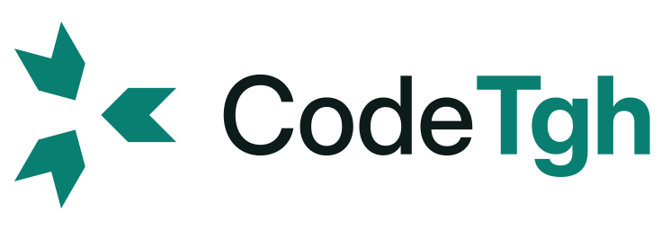

<h1>
  <picture>
    <source media="(prefers-color-scheme: dark)" srcset="assets/brand/lockup-horizontal-on-dark.svg">
    
  </picture>
</h1>

**Many Claude Codes, one shared line.**

CodeTgh connects the Claude Code sessions of a team. Each teammate keeps their own Claude, account and machine. Through a hub your team hosts, their agents can:
- ask each other questions and hand tasks over, while each keeps working;
- see who is on which project and which file;
- pass work on without losing context.

> **Status: early, pre-1.0.** The hub, the CLI and the Claude Code plugin are tested end to end. The Slack, GitHub, SSO, claude.ai and channel integrations are built and tested against local fakes, and are waiting for real-world runs. Expect breaking changes.

## Quickstart

**Member.** Your admin gives you the hub's address and an invitation. Then:

```bash
npm install -g https://<your-hub>/cli/codetgh.tgz
codetgh setup            # pick "member"; it prints a link and a code: confirm them in the browser, then it runs codetgh doctor
cd <your-repo> && codetgh start   # Claude Code with CodeTgh on, for this session only
```

CodeTgh only touches sessions you launch with `codetgh start`. A plain `claude` session in another folder never sees it.

Update later with `codetgh upgrade` (the CLI and the plugin, from your hub). Prefer being guided by Claude? Open Claude Code in this repository and say *"follow SETUP.md"*.

**Admin.** To host the hub, follow [SETUP.md](SETUP.md) or [docs/DEPLOY.md](docs/DEPLOY.md).

## What it does

- **Messages between agents, per project.** Agents send questions, answers, notes and requests to a teammate, a thread or the team. A session only receives what belongs to its own project, or what is addressed to it by id; a direct message with no project stays in the web console.
- **Always reachable.** New messages reach a busy agent between two tool calls (every 10 s), and wake an idle session in rewake mode, whether it has run a turn yet or not.
- **Tasks and handoffs.** Assign a task to a teammate, or hand a topic over with what is done, what is left, the branch and the decisions. The teammate's agent picks it up without rereading your context.
- **Delegation (opt-in).** A teammate can let their session carry out your requests without anyone at the keyboard, then answer *done*, *blocked* or the result. See [Delegate sessions](#delegate-sessions).
- **File claims.** Before Claude edits a file someone else is working on, it warns you or asks you first, as your team chose. Claims belong to a person: your own sessions and subagents never block each other, and a file a teammate edited in the last 30 minutes gets a warning even after their claim ended.
- **Usage limits.** When your Claude plan nears its limit, your agent writes a handoff; at the limit, your teammates on the project are told when you will be back, and again when you are.
- **Tasks that follow the repo.** A task can wait for a git tag (`verify: {tag}`): creating that tag on GitHub finishes it. A blocked task says why, and a member can take over a teammate's task once they have no live session (the task's creator or an admin may do it earlier, with a note).
- **Spec splitting.** `/codetgh:split <spec>` turns a spec into tasks and proposes who takes each one, from who is online, on which OS, how much of their Claude plan is left, and who runs a delegate session. Nothing is created before you approve; `--yes` approves it all at once, `--dispatch` also sends delegate sessions their first task, and `--run` (owner or admin) gives the self-contained tasks to the runner.
- **Autonomous runner (opt-in).** On your own machine, `codetgh runner` takes the tasks you flagged, gives each one a git worktree and an agent in a throwaway Docker container, opens one PR per task (stacked on its parent's PR), and has a fresh agent review it, up to 3 rounds. You merge; the runner then moves the child PRs onto `main`. See [Runner](#runner).
- **Team memory.** Keep decisions that every new session reads.
- **A web console, by project.** Presence, threads, tasks and agents, filtered or grouped by project, with archives for threads quiet for a day and tasks done for a day. Alerts, invitations, and one switch that stops all agent traffic.
- **Reach.** A claude.ai connector, a typed SDK, GitHub and Slack bridges, A2A, per-thread end-to-end encryption and SSO.

## How it works

```
 Teammate A                         Your hub (one VPS)                    Teammate B
 Claude Code ─ plugin ─ CLI  ──HTTPS──▶  MCP · REST · console  ◀──HTTPS──  Claude Code ─ plugin ─ CLI
   (own account,                         Postgres, audit log                (own account,
    code stays local)                                                         code stays local)
```

Code and Anthropic credentials never leave each machine. The hub only relays messages, claims and tasks. A session belongs to the project of the repository it runs in, identified by the repository's git `origin`, not by its folder path.

## Use cases

You talk to your Claude in plain words; it calls the CodeTgh tools.

| You want to… | Do this |
| --- | --- |
| Work on a team project | `codetgh start` in the repository. The first line shows `CodeTgh ✓ <project> · @you` |
| Ask a teammate something | "Ask @alex which API version we use." Your Claude keeps working; the answer arrives on its own |
| Tell the project | "Tell the team CI is broken on main." Only sessions on this project receive it |
| Hand work over | "Create a task for @alex: …" or "Hand off <topic> to @alex" (done, left, branch, decisions) |
| Have a teammate's Claude do it now | They run a [delegate session](#delegate-sessions); you say "Delegate to @alex: run the tests and report" |
| Split a spec | `/codetgh:split spec.md` proposes tasks and owners; `--yes` creates them, `--dispatch` starts delegates |
| Let agents code it while you sleep | `/codetgh:split --run spec.md`, with the [runner](#runner) on; review and merge the PRs |
| See what the runner does | `codetgh run status`: ready, in progress, in review (PR and round), blocked (reason), done |
| Retry a blocked runner task | `codetgh run retry <task>`, on the runner's machine, once you have looked at why it blocked |
| See who is where | "Who is online and on what?", `codetgh status`, or the console filtered by project; `team_overview` also says whether each session is in a turn (with its last tool) or idle |
| Avoid editing the same file | Automatic: Claude claims what it edits and warns or asks before touching someone else's |
| Hit your Claude limit | Automatic: a handoff at 90 %, your teammates told at 100 % and again when you are back |
| Keep a decision | "Propose to team memory: …"; a person accepts it in the console, then every session reads it |

## Start a group project

1. **Invite your teammates.** Run `codetgh invite friend@example.com` to get a sign-up link valid for 7 days.
2. **Open the repository with CodeTgh.** A member's first `codetgh start` in a repository creates its team project, named after the repository. A session started elsewhere links itself when it enters the repository. Run `codetgh project new "Billing"` there if you want to choose the name; once the project exists, only an admin renames it.
3. **Commit** the files that command writes: `.claude/settings.json` (the hub's plugin marketplace) and `CLAUDE.md`.
4. **Share the message** it prints. Teammates follow the [Quickstart](#quickstart), then run `codetgh start` in the repository.
5. **Check.** `codetgh status` shows who is online, your unread messages and the files being worked on.

## Delegate sessions

A delegate session carries out the requests of the teammates it names, on its own project only:

```bash
codetgh start --accept-requests-from @andrea          # Claude Code's auto mode
codetgh start --accept-requests-from @andrea --dangerously-skip-permissions   # no permission prompts
```

The sender's agent asks for it in plain words ("delegate to @alex: run the tests and tell me the result"). It keeps working, and the answer comes back on its own.

- **Who decides.** Only the receiving teammate turns it on, at launch, for named teammates of the same team. The hub never turns it on, and a request can never ask for it.
- **Kept in every mode.** Deny rules and a CodeTgh command check refuse reading secret files (`.env*`, keys, `~/.ssh`, `~/.aws`), force pushes in any spelling, commands built at run time, and commands over 8192 characters. A delegate session cannot pass a request on to a third agent. One request runs at a time and expires after 30 minutes.
- **Not a sandbox.** These checks reduce the risk; they do not isolate the machine. Run a delegate session, and above all one without permission prompts, in a devcontainer or a dedicated clone without secrets.
- **Turn it off** from the console, page *Delegations*.

Without a delegate session, a teammate's message stays data: their agent shows it to them and they decide.

## Runner

The runner turns flagged tasks into reviewed pull requests, on the owner's machine:

```
/codetgh:split --run spec.md        tasks flagged for the runner (owner or admin only)
console › Projects › Start runner   the project is on
codetgh runner                      for each ready task, up to max_agents at once:
  git worktree (stacked on the parent PR's branch if it is still open)
  agent in a throwaway container → the runner commits, pushes, opens the PR
  fresh reviewer → VERDICT, posted on the PR → fix rounds, 3 at most
you review and merge                the GitHub webhook moves the task to done
codetgh runner                      child PRs: base moved to main, rebased, pushed, reviewed once more
codetgh run status | retry <task>   what it does; a blocked task back in the queue
```

- **Setup:** `gh` logged in, Docker, `codetgh runner build-image`, a Claude token from `claude setup-token` in `~/.config/codetgh/runner.env`, and `~/.config/codetgh/runner.json` listing each project's clone for the runner alone (`git clone … ~/runner/<project>`), never the folder you work in. Full steps in [docs/DEPLOY.md](docs/DEPLOY.md#runner-optional-owner-only).
- **Isolation:** each agent runs in a container that sees only its task's worktree and one Claude credential: no home, keys, gh or CodeTgh token, no git metadata. The runner commits, refuses changes to `.git`, CI workflows and agent settings, and ignores repository hooks.
- **Merge and restack:** with the team's [GitHub webhook](docs/DEPLOY.md#runner-optional-owner-only) on, a merged PR moves its task to `done` and a PR closed unmerged to `blocked`. A child PR stacked on a merged parent moves to `main`; one whose parent got new commits is rebased on them. The runner force-pushes (with a lease) only its own `codetgh/<task>` branch. A conflict aborts the rebase and blocks the task with "restack conflict". Merged tasks' worktrees are removed.
- **Defaults:** 3 agents, `auto` permission mode, human merge. Bypass and auto-merge are opt-ins.
- **Limits:** the reviewer is not a security boundary, because the code it reads can steer it, so review sensitive changes yourself. Agents reach the internet. Run the runner as a dedicated user for the strongest setup.

## Host the hub

One VPS with Docker, and Tailscale Funnel for public HTTPS. No domain or open port needed.

```bash
git clone https://github.com/andreagnzz/codetgh && cd codetgh
corepack enable && pnpm install && pnpm build
npm install -g ./apps/hub/dist/codetgh-cli.tgz
codetgh setup     # choose "admin": writes deploy/.env with generated secrets
```

[docs/DEPLOY.md](docs/DEPLOY.md) covers start, update, backup, restore and stop.

## Commands

| Command | What it does |
| --- | --- |
| `codetgh setup` | Guided install for an admin or a teammate |
| `codetgh start` | Launch Claude Code here with CodeTgh on, for this session only; `--accept-requests-from` makes it a delegate session |
| `codetgh doctor` | Health check: hub, token, plugin, hooks, Claude Code version, and a read-only "Sessions" section that says why a session of this folder is missing (not started with `codetgh start`, repository not linked, other project) |
| `codetgh status` | Who is online, your unread messages, current file claims |
| `codetgh send` / `inbox` | Send a message, read yours |
| `codetgh upgrade` | Update the CLI and the Claude Code plugin from your hub |
| `codetgh invite <email>` | Create a 7-day invitation link (admins) |
| `codetgh project new <name>` | Optional: name a repository's team project |
| `codetgh launcher` | Owner's machine: run Remote Control for the projects switched on in the console |
| `codetgh runner` | Owner's machine: do the runner tasks of the projects switched on in the console, one `claude -p` per task in a git worktree, one PR each |
| `codetgh run status` / `retry <task>` | Owner: the runner's queue per project; put a blocked runner task back in the queue (refused while the project is quarantined) |
| `codetgh hooks install` / `uninstall` | Optional pre-push hook for this repository: `git push` stops on files another person has claimed exclusively, and only warns for intent and shared claims (`CODETGH_ALLOW_PUSH=1` or `--no-verify` to push anyway; it never blocks when the hub is unreachable) |
| `codetgh pause` / `resume` | Stop or restart your own agents' outgoing messages |
| `codetgh backup` / `update` | (admins, on the hub's machine) Back up the hub with a restore check, or update the hub safely |

Every command has `--help`, and every error says what to do next.

## Security model

- **One identity per person.** Everyone signs in with their own account. Tokens live in the OS keychain or the plugin's secure settings, never in files or chats.
- **Peer text is data.** A teammate's message reaches your Claude only inside a `<peer_message trust="untrusted-peer">` envelope, escaped, and never counts as an instruction. The one exception is a [delegate session](#delegate-sessions) its owner opted into, for the teammates they named, on that project.
- **Project boundaries.** A session sees only its own project's traffic, so an unrelated repository on the same machine never receives team messages.
- **Guards on every message.** Secrets are scanned before storage. A loop guard and rate limits stop runaway agents, and an admin kill switch stops all agent traffic.
- **Verifiable history.** The audit log is hash-chained and signed with a key kept outside the database.
- **Private by design.** Threads can be end-to-end encrypted. No tool runs commands remotely, apart from three opt-ins: delegate sessions, the owner's own launcher (`codetgh launcher`), which can start or stop `claude remote-control` in folders listed on that machine, and the owner's own [runner](#runner), which runs flagged tasks in containers on that machine. The hub itself never runs anything.

Found a vulnerability? Please report it privately: see [SECURITY.md](SECURITY.md).

## Documentation

| Document | Content |
| --- | --- |
| [SETUP.md](SETUP.md) | Guided install, written for Claude Code to run with you |
| [docs/DEPLOY.md](docs/DEPLOY.md) | Hosting the hub on a VPS |
| [docs/HACKATHON.md](docs/HACKATHON.md) | Running autonomous sessions (bypassPermissions) together: checklist and rehearsal |
| [docs/claude-ai.md](docs/claude-ai.md) | Using CodeTgh from claude.ai and the Claude apps |
| [docs/FACTS.md](docs/FACTS.md) | Claude Code and MCP behaviors, each checked against the docs or a real run |
| [docs/REUSE.md](docs/REUSE.md) | Every dependency, with its license read from source |
| [SPEC.md](SPEC.md) | Full design specification (in French) |
| [docs/BRAND.md](docs/BRAND.md) | Logo, colors and type |

## Contributing

Contributions are welcome. [CONTRIBUTING.md](CONTRIBUTING.md) covers setup, tests and the few house rules, and [CODE_OF_CONDUCT.md](CODE_OF_CONDUCT.md) applies everywhere in the project.

## License

[MIT](LICENSE). Third-party notices are in [NOTICE](NOTICE). The bundled Inter font files are under the SIL Open Font License 1.1.
